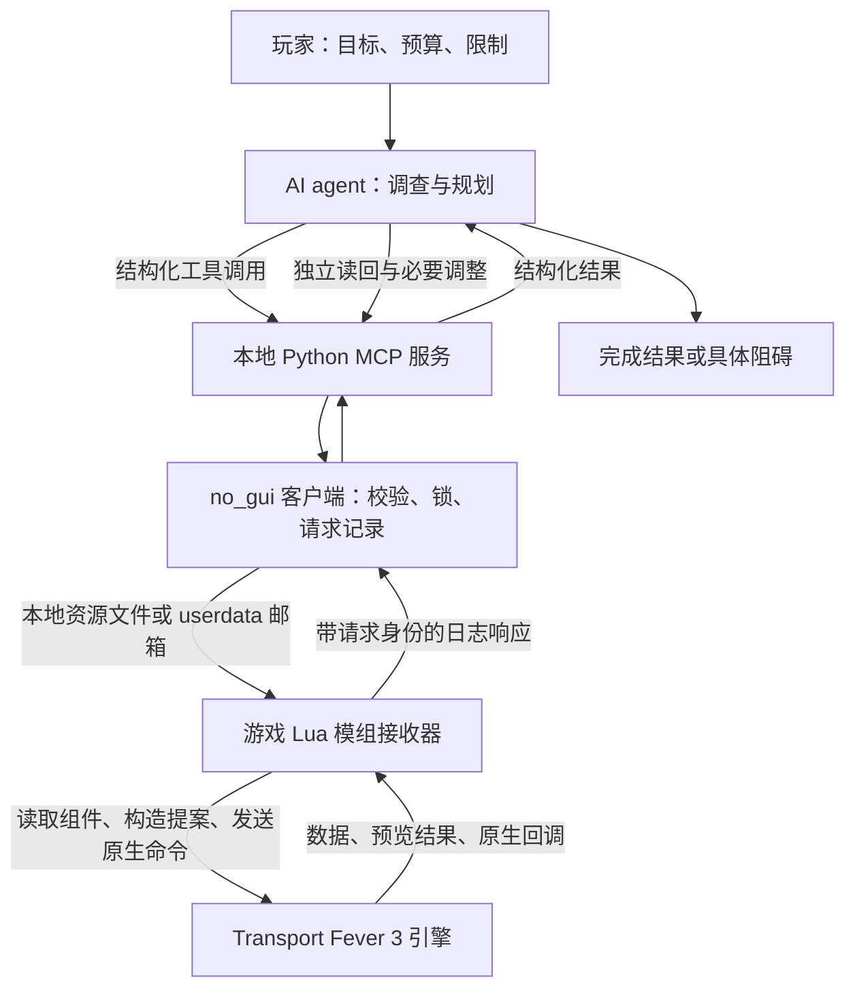

# AI 如何通过 MCP 控制 Transport Fever 3

更新日期：2026-10-16。本文依据本项目当前 Python 服务、Lua 模组和已记录的实机验证，介绍从自然语言任务到游戏执行的全过程。它是实现说明，不是施工授权，也不会启动游戏或监控。

## 1. 从一句话到游戏中的变化

例如玩家说：“给这座城市建一条蔬菜供应线。”AI 首先需要知道城市实际需要什么、附近哪里有货、有哪些可用道路和站点、账户有多少钱。它通过工具读取这些信息，制定方案，再把方案拆成可执行的请求：预览道路、建站、接路、创建线路、购买车辆、分配线路、检查车辆是否正常运行。

本项目采用游戏 API 控制作为主要方式。AI 不必逐次模拟鼠标点击工具栏，也不直接把自然语言交给游戏引擎。自然语言先由 AI 转换为带明确参数的工具调用，游戏端执行的是模组支持的命令。

三个角色各自负责不同的事情：

| 角色 | 主要职责 | 不负责什么 |
|---|---|---|
| AI agent | 理解目标、调查现状、制定方案、选择工具、根据反馈调整步骤 | 不自行决定原生碰撞是否允许，也不能把猜测当成现场数据 |
| MCP 服务与桥接模组 | 校验参数、传递请求、执行支持的操作、记录状态并返回结果 | 不内置一个能自主规划城市的 AI 模型 |
| 游戏引擎 | 保存真实世界状态，处理地形、建造、车道、寻路、车辆运动和经济模拟 | 不理解玩家的完整自然语言目标 |

因此，“能做什么”同时取决于提示词、agent 的决策、已加载接口及游戏原生能力。提示词可以改变目标和策略，但不能凭空增加尚未实现的接口。

## 2. 整体架构



MCP 是 AI 客户端与工具服务之间的协议。本项目的 MCP 服务通常作为本地进程通过标准输入输出与客户端通信；MCP 本身不是游戏网络协议。真正进入游戏的后一段，由本地桥接通道完成。

主要实现位置：

| 文件 | 作用 |
|---|---|
| [server.py](../../server/src/tf3_mcp/server.py) | 注册 MCP 工具，声明参数和说明，分派调用 |
| [no_gui_client.py](../../server/src/tf3_mcp/no_gui_client.py) | 异步请求、会话绑定、兼容入口转换、等待结果及流程编排 |
| [no_gui.py](../../server/src/tf3_mcp/no_gui.py) | 接收器状态、公共锁、文件发布、请求账本、能力和保存证据校验 |
| [ui_log.py](../../server/src/tf3_mcp/ui_log.py) | 命令参数白名单、类型检查、请求与日志结果解析 |
| [bridge.script.lua](../../mod/tf3_mcp_bridge/content/tf3_mcp_bridge/bridge.script.lua) | 游戏侧数据读取、提案生成、命令执行、保护和结果序列化 |
| [scripts 目录](../../scripts) | 将多个工具调用组织成规划、施工、验收等任务流程 |

## 3. 一次请求如何往返

以 `get_town_overview(town=当前城市ID)` 为例：

1. AI 选择工具并填写参数。城市 ID 来自本次读取，不从旧存档记录直接照搬。
2. MCP 服务接收调用。启用 `TF3_MCP_TRANSPORT=no_gui` 时，请求进入内部 no_gui 客户端。这不表示游戏无窗口运行。
3. 客户端核对游戏接收器心跳、当前会话、可用能力和未决请求。例如城市概览要求 `townOverviewVersion=1`，磁盘上有新代码并不代表游戏已经加载它。
4. 主机校验命令及参数，建立请求 ID 和持久记录，将请求发布到接收器指定的通道。通道可能是单次 Lua 资源文件，也可能是原生 userdata 邮箱；具体按安装配置和实时心跳选择。
5. Lua 接收器在游戏运行周期中读取请求，校验身份、代次、有效窗口等条件，将命令交给相应处理器。需要引擎上下文的读取或写入由相应引擎侧逻辑处理。
6. 处理器读取原生数据或执行原生命令，将结果转为可传输的数据，并输出可识别的日志响应。
7. Python 根据原请求身份读取响应，把结果返回给 AI。AI 根据结果继续读取、调整方案或报告完成。

这种文件与日志桥接使外部进程可以与游戏内模组通信。文件和日志是传输载体，模组对原生 API 的封装才决定了操作能力。通信方式、接收器模式及旧 `request.lua` 的条件见[通信通道说明](../reference/TRANSPORT_CHANNELS.md)。不同通道的安装与资源发现限制见[下载版连接说明](../reference/MODIO_CONNECTION.md)。

### 并非所有函数名都对应同一种执行方式

公开 MCP 工具、内部通道命令和 Lua 处理器是不同层次。有些公开工具是便捷入口，no_gui 客户端会把它转换为更严格的内部命令。例如道路建造便捷入口在 no_gui 模式下要求显式预览，再单独提交令牌；不能按照旧参数说明直接假定 `preview=False` 会立即施工。

下文同时列出公开入口和内部命令，用来解释流程，不保证每个内部命令都作为独立按钮出现在所有客户端的工具列表中。实际参数应以当前 MCP 工具定义、no_gui 支持列表和已加载版本为准。

## 4. AI 怎样读取游戏

游戏世界中的城市、道路、建筑、线路和车辆都有实体 ID，并通过组件保存不同类型的数据。例如道路包含端点、几何和车道，线路包含停靠站序，车辆包含线路分配和运动状态。读取通常分为“找对象”和“取明细”两步。

| 要回答的问题 | 典型读取入口 | 结果如何使用 |
|---|---|---|
| 当前是什么地图、时间和资金状态？ | `get_game_state`、`get_map_info`、`get_finances` | 确认现场、现金和任务范围 |
| 有哪些城市、线路、站点或车辆？ | `list_towns`、`list_lines`、`list_stations`、`list_vehicles` | 获得当前实体 ID，再定向查询 |
| 城市缺什么？ | `get_town_cargo_supply` | 使用实际需求、供给及可比指标 |
| 城市评分和环境如何？ | `get_town_overview` | 读取声誉、运送、噪音、加成、幸福感、交通和污染 |
| 哪个位置能放设施或接路？ | `get_terrain`、`get_terrain_grid`、`find_nearby` | 核对地形、水域、道路端点及附近对象 |
| 道路或建筑具体配置是什么？ | `get_entity`、`get_network_template`、`get_facility_config` | 核实车道、资源、模块与兼容性 |
| 车辆有没有实际运行？ | `get_vehicle_motion`、`list_vehicles` | 检查位置、速度、线路及原生寻路故障 |

数据并不总是普通 JSON。游戏 API 可能返回 Lua userdata、原生记录和特殊集合，桥接需要按照已知字段结构序列化。读取失败、字段缺失和真实数值0必须分开：例如城市概览中的 `overview.emissionsPower` 当前不可读，总标记可能为 `complete=false`，但其他成功返回的分项仍可使用。

大范围读取需要分页；`hasMore`、`nextOffset` 和实际返回上限决定是否读全。单次局部查询没有结果，不等于全图没有该对象。地图快照用于规划，也不代替提交前的新鲜现场核对。

## 5. 怎样把规划变成道路

AI 先确定起终点、道路用途和所需运输模式，再读取地形、现有节点及道路模板。随后把路线表达为道路图：节点表示三维位置或已有连接点，边表示道路段、模板和曲线切线；桥隧还需显式指定结构类型和原生资源。

典型流程如下：

1. **调查**：查询实际端点、地形、周边对象，以及模板允许的 CAR、BUS、TRUCK、TRAM 等通行模式。
2. **设计**：形成节点和边，保证真实连接。两条线在平面上相交，不代表游戏已经建立路口；立交则需不同高程和分离节点。
3. **预览**：调用 `preview_road_graph`，由桥接构造原生提案，返回可施工性、碰撞、警告及可获得的费用。红绿灯、转向和横道也可在受支持的道路图方案中表达。
4. **保存和提交**：在有效授权和资金条件下保存备份，检查预览是否仍有效，调用 `commit_road_graph` 消费一次性令牌。
5. **读回**：检查真实新边、端点、车道、桥隧类型及原有对象是否符合方案，再检查需要的有向通路。

道路升级通过 `preview_road_upgrade` 和 `commit_edge_edit` 将已有路段换成目标模板。当前可把限定的普通地面道路升级为电车或公交道路，但不支持任意逐车道修改，也不支持通过这个入口升级桥隧或带站牌的路段。

**预览能力存在差别。** 全新道路图可以取得原生建造预览；道路升级以及部分旧路切分只提供结构检查，没有完整报价或碰撞预览。已知某些移除提案进入原生预览可能触发断言，因此不能为追求“全部有预览”而调用已知危险路径。应明确返回缺口，并依具体任务的预算与授权边界处理。

已记录的例子包括普通道路升级成电车／公交道路，以及约20米埋深电车隧道的建造和实车穿越。后者通过车辆运动采样证明穿越，不仅是看到地图上出现隧道。见[道路升级](../reference/ROAD_UPGRADE.md)、[道路图](../reference/ROAD_GRAPH.md)及[路口与信号](../reference/ROAD_GRAPH_SPECIAL.md)。

## 6. 怎样建造建筑和运输设施

建筑方案除了坐标，还包含朝向、高程、原生资源、参数和模块。AI 需要先决定设施的用途，再核对当前资源能否提供需要的客运、货运、仓储、维护或购车能力。资源目录里存在某个建筑，不等于 MCP 已支持直接新建它。

以货车站或电车库为例：

1. 查询附近道路、地形和可复用设施，确定候选位置与朝向。
2. 使用对应设施预览入口，例如内部命令 `preview_station`、`preview_depot`，或专用建筑工具。
3. 由 Lua 模组生成原生建筑提案，核对占地、碰撞、可用参数、报价和必要的接路条件。
4. 通过对应提交入口，例如 `commit_structure` 或 `commit_facility`，单次执行。
5. 读取真实建筑、站点、模块、仓储和外部端口，再验收交通连接。

“建筑已经建成”不等于“车辆可以到达”。设施内部道路可能仍未接入外部路网。部分公路设施支持联合贴路建造，通过原生入口发现与必要基础高程校正，将真实入口绑定到道路节点；其他情况则分阶段建造，再读取实际端口并单独接路。不能只按建筑中心到道路的距离判断已接通。

仓库、港口等模块化设施还需要检查共同库存和装卸关系。附近有货不等于目标站能装货，仓库有库存也不等于城市已经收到货物。详见[设施支持范围](../reference/FACILITY_SUPPORT.md)和[自动贴路流程](../reference/AUTO_ROADSIDE_PLACEMENT.md)。

## 7. 怎样创建线路并让车辆运行

路线规划是 AI 的方案，游戏线路则是一个具体的原生实体。两者之间还需要设施、终端、道路连通和车辆配置。

1. **确认完整运输链**：生产端装货点、目标卸货点、沿途路网和车库出口都要连续通达；客运则核对可用客运终端。
2. **创建线路**：`create_line(station_groups, name)` 使用当前站组 ID 建立空线路。它本身不买车、不证明线路能运行，也不会自动建设沿途道路。
3. **配置停靠规则**：核对站序、站内终端、允许装载的货品或乘客、卸货和等待规则。内部线路预览与提交命令负责将配置写入，并检查对象是否变化。
4. **选择与购买车辆**：查询当前可购车型、价格、运输模式、容量和基地兼容性。no_gui 普通单车采购与线路分配是分开的请求；多步流程可以由带明确批次记录的编排入口组织。
5. **分配并出库**：`assign_vehicles` 将车辆分配给线路及指定停靠索引。此时只有配置完成，尚不能宣布已正常运营。
6. **运行验收**：必要时按授权临时推进模拟，读取车辆位置和速度，确认实际离开基地、正常执行线路且没有原生故障；完成后恢复本次流程改变的速度状态。

常规投运验收不要求额外等待全程往返或收集上下客、交付数量。但若任务本身是“验证穿越地下隧道”，就必须继续取得车辆进入并驶出测试段的证据；若目标是“城市供货达到某个比例”，还必须另行读取城市供给指标。车辆出库、实际交付和供货目标达成是三个不同结论。

## 8. 为什么需要预览、锁和结果记录

游戏操作会改变持久世界。网络或日志超时可能发生在命令已经执行之后，因此“没收到结果”不等于“没有施工”。重复发送同一次建造可能造成重复对象或更严重的不一致。

| 机制 | 要解决的问题 |
|---|---|
| 会话、代次与地图身份 | 避免将旧存档的实体和请求用于新现场 |
| 能力版本检查 | 防止向旧接收器发送尚未支持的命令 |
| 公共工作流锁与客户端锁 | 防止多个流程交错发送相关操作 |
| 参数白名单及类型检查 | 拒绝错误命令、无效 ID、未知选项和不受支持的组合 |
| 预览令牌与对象签名 | 确认提交对应刚才的方案，对象变化或令牌过期后须重新预览 |
| 提交前保存 | 提供可核验的恢复点；恢复读档仍需相应授权 |
| 持久请求记录与 pending | 标记已发送但结果未确认的操作，防止盲目重发 |
| 独立读回 | 将“命令接受”与“实际世界符合预期”分开确认 |

常见处理逻辑可以概括为：

```text
读取当前状态
→ 检查任务授权、资金、接口能力和未决请求
→ 形成一个可执行方案
→ 预览并核对结果
→ 保存必要备份，刷新失效的预览
→ 记录提交意图，发送一次
→ 读取原请求结果
   ├─ 明确成功：独立读回，继续下一依赖步骤
   ├─ 明确未执行的拒绝：定位原因，允许范围内修正后重新规划
   └─ 超时、部分成功或结果未知：保留记录和写入保护，核对原请求
→ 达到任务要求的验证层级后报告结果
```

预算、现金底线、禁止新增贷款等属于任务政策，执行者及工作流必须主动检查；不能假定每个底层工具都会自动执行所有聊天规则。当前项目指令中的资金政策见[AGENTS.md](../../AGENTS.md)，本文不复制历史金额作为新的操作授权。

## 9. 为什么 AI 操作比手动点击耗时

一次“建条线路”实际包含多轮查询、规划、原生预览、提交、等待回调和读回。文件与日志通道需要等待游戏处理，AI 每次拿到结果后还要判断下一步；真实车辆通行又需要推进游戏模拟。这些步骤都会增加时间，AI 推理和工具结果处理也会消耗模型服务的 token。

可以通过复用同轮调查、局部查询、分页读取、减少无关字段和有边界的流程脚本提高效率。但不能用缓存代替施工前现场核对，也不能通过并发提交或跳过结果确认来省略必要的保护。

持续运营监控是另一层任务编排：由已配置的调度器按规则唤起 agent，agent 再使用相同接口调查和操作。安装桥接模组本身不会自动启动监控，也不会自动获得无限建设或融资权限。

## 10. 阅读代码与继续了解

建议先看 `server.py` 中某个工具的定义，再沿 `no_gui_client.py` 的分派和 `no_gui.py` 的请求发布，追到 Lua 模组中的对应命令处理器，最后查看独立读回及测试。这样可以分别判断：工具是否注册、通道是否支持、游戏是否已加载、现场是否验证成功。

- [Agent 执行手册](AGENT_PLAYBOOK.md)：现场操作、恢复及已知崩溃边界。
- [城市概览](../reference/TOWN_OVERVIEW.md)：原生读取、可用性和统计口径。
- [道路图](../reference/ROAD_GRAPH.md)、[道路升级](../reference/ROAD_UPGRADE.md)：路段、路口、车道及桥隧。
- [路线规划](ROUTE_PLANNING.md)、[载具投运验收](CARRIER_ACCEPTANCE.md)：从运输需求到实际运行。
- [保存与读档](../reference/LOAD_GAME.md)：恢复点和新会话验证。
- [地下电车实车记录](../../output/tram_tunnel_20m_20261015/RESULT.md)：从预览、建设到运动证据的完整实例。


## 接收器只读批处理

新增 `read_batch` 可将最多16项白名单查询通过一次消息送入接收器，顺序执行并逐项返回结果。它减少往返开销，不提供原子快照，不允许施工或嵌套批处理。需要实际加载 `readBatchVersion=1`；限制及验证状态见[只读批处理](../reference/READ_BATCH.md)。
